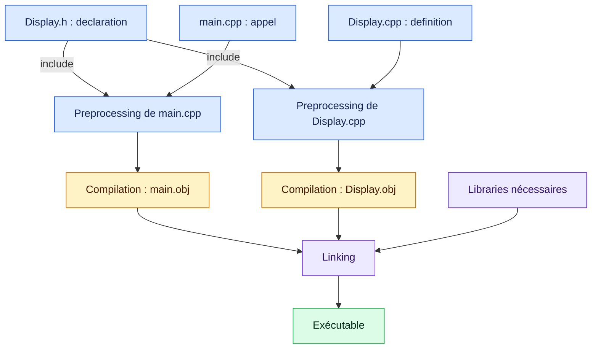

# Révision 1 : Functions, files et compiler

[Sommaire](./README.md) · [Révision 2 →](./02_Values_References_Pointers.md)

## Objectifs

- Extraire une function de `main` et distinguer affichage et return value.
- Distinguer declaration et definition.
- Organiser les headers et les source files.
- Comprendre le rôle du preprocessor, du compiler et du linker.

**Prérequis :** Savoir déclarer une variable, écrire une expression et lire un `main` simple.

<details>
<summary>📑 Sommaire de la fiche</summary>

- [1. Extraire une function de `main`](#1-extraire-une-function-de-main)
- [2. Declaration et definition](#2-declaration-et-definition)
- [3. Pourquoi l’ordre compte-t-il ?](#3-pourquoi-lordre-compte-t-il-)
- [4. Séparer les files `.h` et `.cpp`](#4-séparer-les-files-h-et-cpp)
- [5. Preprocessor et `#include`](#5-preprocessor-et-include)
- [6. Include guard et `#pragma once`](#6-include-guard-et-pragma-once)
- [7. Du code à l’exécutable](#7-du-code-à-lexécutable)
- [8. Declaration sans definition : pourquoi une erreur LNK ?](#8-declaration-sans-definition--pourquoi-une-erreur-lnk-)
- [Exercices](#exercices)
- [À retenir](#à-retenir)
- [Avant de terminer](#avant-de-terminer)
- [Références](#références)

</details>

## 1. Extraire une function de `main`

Au départ, on calcule et on affiche directement dans `main` :

```cpp
#include <iostream>

int main()
{
    int value = 5;
    int result = value * 2;

    std::cout << "Twice of " << value << " is: " << result << std::endl;

    return 0;
}
```

Pour réutiliser ce travail, on le déplace dans une function :

```cpp
#include <iostream>

int DisplayTwice(int value)
{
    int result = value * 2;

    std::cout << "Twice of " << value << " is: " << result << std::endl;

    return result;
}

int main()
{
    int doubled = DisplayTwice(5);
    DisplayTwice(8);

    return 0;
}
```

**La definition de `DisplayTwice` est en dehors des accolades de `main`.** En C++, une function classique ne peut pas être définie à l’intérieur d’une autre function.

Le programme affiche :

```text
Twice of 5 is: 10
Twice of 8 is: 16
```

### Parameter, argument et retour

Dans `int doubled = DisplayTwice(5);` :

1. `5` est l’**argument** fourni à l’appel.
2. Le **parameter** `value` reçoit une copy de cette value.
3. La function calcule et affiche son résultat.
4. `return result;` termine cet appel et transmet la value calculée.
5. `doubled` reçoit donc `10`.

**Afficher et retourner sont deux actions différentes :**

- `std::cout` écrit dans la console.
- `return` transmet une value au code appelant.

L’appel `DisplayTwice(8);` affiche son résultat, mais ignore la return value.

Les variables locales `value` et `result` ne sont pas accessibles directement depuis `main`. Ici, `main` récupère la value calculée grâce au retour.

Dans `main`, `return 0;` indique une fin normale du programme.

📖 **Pour approfondir :** [Functions (Basics), Hacking C++ (EN)](https://hackingcpp.com/cpp/lang/function_basics) pour revoir les appels, parameters et return values. Alternative en français : [Découpez votre programme en fonctions, OpenClassrooms (FR)](https://openclassrooms.com/fr/courses/1894236-apprenez-a-programmer-en-c/7533556-decoupez-votre-programme-en-fonctions).

## 2. Declaration et definition

### Declaration : annoncer la function

```cpp
int DisplayTwice(int value);
```

Elle indique :

| Élément | Signification |
|---|---|
| `int` avant le nom | Return type |
| `DisplayTwice` | Nom de la function |
| `int value` | Parameter de type `int` |
| `;` | Fin de la declaration |

### Definition : fournir les instructions

```cpp
int DisplayTwice(int value)
{
    int result = value * 2;

    std::cout << "Twice of " << value << " is: " << result << std::endl;

    return result;
}
```

La definition contient le **function body**, entre accolades.

> [!NOTE]
> **Declaration ou definition ?**
> Une definition est aussi une declaration. Si la definition est visible avant l’appel, une declaration séparée n’est pas nécessaire.

### Function signature

Pour notre free function non template, la signature repose sur son **nom et les types de ses parameters**, dans son namespace.

Ces deux declarations annoncent la même function :

```cpp
int DisplayTwice(int value);
int DisplayTwice(int number);
```

Le nom du parameter ne change pas la signature.

Le return type doit être cohérent entre declaration et definition, mais **ne permet pas à lui seul de distinguer deux overloads**.

## 3. Pourquoi l’ordre compte-t-il ?

Le compiler doit connaître la function lorsqu’il rencontre son appel.

On peut :

- placer la definition avant l’appel ;
- ou placer une declaration avant l’appel, puis la definition plus bas.

```cpp
#include <iostream>

int DisplayTwice(int value); // Declaration avant l’appel.

int main()
{
    int doubled = DisplayTwice(5);

    return 0;
}

int DisplayTwice(int value) // Definition après main.
{
    int result = value * 2;

    std::cout << "Twice of " << value << " is: " << result << std::endl;

    return result;
}
```

**Une definition située après `main` ne suffit pas si aucune declaration n’est visible avant l’appel.**

Cet ordre concerne la compilation. À l’exécution, la function s’exécute lorsqu’elle est appelée, pas parce qu’elle apparaît en haut du fichier.

## 4. Séparer les files `.h` et `.cpp`

On place la declaration dans un **header**, puis la definition dans un source file.

### `Display.h`

```cpp
#pragma once

int DisplayTwice(int value);
```

### `Display.cpp`

```cpp
#include "Display.h"
#include <iostream>

int DisplayTwice(int value)
{
    int result = value * 2;

    std::cout << "Twice of " << value << " is: " << result << std::endl;

    return result;
}
```

### `main.cpp`

```cpp
#include "Display.h"

int main()
{
    int doubled = DisplayTwice(5);

    return 0;
}
```

| Fichier | Rôle dans cet exemple |
|---|---|
| `Display.h` | Annoncer la function aux fichiers qui l’utilisent |
| `Display.cpp` | Fournir son implémentation |
| `main.cpp` | Appeler la function |

**Points importants :**

- `Display.cpp` inclut son propre header pour vérifier la cohérence entre declaration et definition.
- `<iostream>` est inclus là où `std::cout` est utilisé.
- On inclut **`Display.h`**, pas `Display.cpp`.
- **Les deux `.cpp` doivent participer à la compilation du projet.** Un fichier présent sur le disque n’est pas forcément ajouté aux sources du projet.

Cette organisation concerne notre function ordinaire. Un header peut aussi contenir certaines definitions, notamment des classes, des templates ou des functions `inline`.

📖 **Exemple guidé :** [Utilisez plusieurs fichiers, OpenClassrooms (FR)](https://openclassrooms.com/fr/courses/1894236-apprenez-a-programmer-en-c/7565936-utilisez-plusieurs-fichiers) reprend la séparation entre headers, source files et prototypes.

## 5. Preprocessor et `#include`

Les lignes comme `#include`, `#define` ou `#ifndef` sont des **directives du preprocessor**.

Avec les inclusions classiques utilisées ici, `#include` insère le contenu du header à cet endroit avant la compilation du C++.

```cpp
#include <iostream>   // Header de la standard library.
#include "Display.h"  // Header de notre projet.
```

Les chevrons et les guillemets utilisent des règles de recherche différentes. On utilise généralement les guillemets pour les headers du projet.

> [!IMPORTANT]
> **Inclure un header ne compile pas son source file.**
> `Display.cpp` doit aussi participer au build pour fournir la definition de la function.

L’inclusion rend la declaration visible. La compilation du source file fournit son implémentation sous forme d’object code.

## 6. Include guard et `#pragma once`

Un header peut être inclus plusieurs fois, directement ou par l’intermédiaire d’autres headers.

On protège habituellement son contenu avec l’une de ces deux méthodes.

### Version courte

```cpp
#pragma once

int DisplayTwice(int value);
```

`#pragma once` évite de traiter plusieurs fois ce fichier dans une même translation unit.

Il est pris en charge par MSVC, GCC et Clang, mais ne fait pas partie du standard C++.

### Version avec include guard

```cpp
#ifndef GTECH_DISPLAY_H
#define GTECH_DISPLAY_H

int DisplayTwice(int value);

#endif
```

- `#ifndef` : conserver le bloc si la macro n’est pas définie.
- `#define` : définir la macro.
- `#endif` : terminer le bloc conditionnel.

À la deuxième inclusion, la macro existe déjà : le contenu protégé est ignoré.

**La protection s’applique par translation unit, pas une seule fois pour tout le programme.** Elle n’empêche pas plusieurs `.cpp` de produire chacun la même definition.

Une simple declaration de function peut être répétée. Les include guards évitent notamment les redéfinitions de classes et de structures lors d’inclusions répétées.

## 7. Du code à l’exécutable

Une **translation unit** correspond ici à un `.cpp` avec le contenu de ses inclusions, après preprocessing.

Chaque `.cpp` est compilé séparément :



| Étape | Travail |
|---|---|
| **Preprocessor** | Traiter les directives, notamment les inclusions |
| **Compiler** | Vérifier le C++ de chaque unité et produire un object file |
| **Linker** | Réunir objets et libraries, et résoudre les references entre eux |

Les object files portent généralement l’extension `.obj` sous MSVC et `.o` sous Linux. Ils ne sont pas encore des exécutables autonomes.

🖼️ **Voir le build en images :** [Separate Compilation, Hacking C++ (EN)](https://hackingcpp.com/cpp/lang/separate_compilation) propose des slides et un diagramme pour relier headers, source files, object files et exécutable.

## 8. Declaration sans definition : pourquoi une erreur LNK ?

Le compiler peut accepter :

```cpp
int DisplayTwice(int value);

int main()
{
    int doubled = DisplayTwice(5);

    return 0;
}
```

Il connaît les types nécessaires pour vérifier l’appel.

Mais si aucune definition correspondante n’est fournie au linker, celui-ci ne trouve pas le code à appeler : **la construction échoue au linking**.

| Erreur | Vérifier |
|---|---|
| Function inconnue à la compilation | Declaration visible avant l’appel ? Header inclus ? Bon nom ? |
| Header introuvable | Nom, emplacement et chemins d’inclusion |
| **LNK2019 / LNK2001** : symbole externe non résolu | Definition existante ? Types correspondants ? `.cpp` compilé ? Library liée ? |
| **LNK2005** : symbole déjà défini | Plusieurs definitions de la même function ? Inclusion d’un `.cpp` ? |
| Programme construit mais résultat faux | Values, appels et logique avec le debugger |

Attention aux types :

```cpp
int DisplayTwice(int value); // Function appelée.
int DisplayTwice(double value) // Autre overload.
{
    return static_cast<int>(value * 2);
}
```

Définir la version `double` ne fournit pas la definition de la version `int`.

> [!WARNING]
> **Une protection locale à chaque translation unit**
> `#pragma once` ne résout pas une definition dupliquée entre plusieurs translation units. Pour notre function non `inline`, conserver la declaration dans le `.h` et une seule definition dans un `.cpp`.

---

## Exercices

Prévoir le résultat, tester, puis expliquer les différences. Pour les erreurs volontaires, identifier l’étape du build qui échoue.

### Exercice 1 : extraire une function

Reprendre le premier programme de la fiche et extraire le calcul et l’affichage dans `DisplayTwice`.

1. Appeler la function avec `5`, puis avec `8`.
2. Stocker la return value du premier appel.
3. Expliquer la différence entre afficher et retourner.

### Exercice 2 : organiser les files

Répartir le programme entre `main.cpp`, `Display.h` et `Display.cpp`.

1. Placer la declaration dans le header et le protéger avec `#pragma once` ou une include guard.
2. Placer la definition dans `Display.cpp` et inclure le header dans les deux source files.
3. Vérifier que les deux `.cpp` participent au build.

### Exercice 3 : identifier l’étape qui échoue

À partir du programme fonctionnel, tester chaque modification séparément, puis rétablir le code initial :

- Retirer l’inclusion de `Display.h` dans `main.cpp`.
- Retirer `Display.cpp` du build, en conservant le header.
- Remplacer le parameter `int` par `double` dans la definition uniquement.

Pour chaque cas, expliquer si l’erreur vient du compiler ou du linker et proposer une correction.

---

## À retenir

> [!TIP]
> **Les repères à garder**
>
> - Une declaration rend la function connue avant l’appel.
> - Une definition fournit son function body.
> - Un header inclus ne provoque pas la compilation du `.cpp` correspondant.
> - Chaque translation unit est compilée séparément, puis le linker réunit les object files.
> - Une include guard protège un header dans une translation unit.

## Avant de terminer

- [ ] Je sais extraire une function de `main` et l’appeler deux fois.
- [ ] Je sais déplacer sa definition après `main`, avec une declaration avant l’appel.
- [ ] Je sais séparer le programme entre `main.cpp`, `Display.h` et `Display.cpp`.
- [ ] Je sais expliquer la différence entre afficher et retourner.
- [ ] Je sais retirer temporairement la definition et identifier l’étape qui échoue.

---

## Références

- [Headers : organiser declarations et inclusions](https://learn.microsoft.com/fr-fr/cpp/cpp/header-files-cpp?view=msvc-170) : Comment partager des declarations entre plusieurs source files et organiser les headers.
- [Translation units, linkage et One Definition Rule](https://learn.microsoft.com/en-us/cpp/cpp/program-and-linkage-cpp) : Pourquoi les files sont compilés séparément et quelles règles encadrent les declarations et definitions.
- [Functions : parameters, appels et return values](https://learn.microsoft.com/en-us/cpp/cpp/functions-cpp?view=msvc-170) : Les éléments d’une function, sa declaration, sa definition et les informations transmises à l’appel.
- [#pragma once : éviter les inclusions répétées](https://learn.microsoft.com/en-us/cpp/preprocessor/once?view=msvc-170) : Le fonctionnement de cette protection et ses liens avec les include guards.
- [LNK2019 : unresolved external symbol](https://learn.microsoft.com/en-us/cpp/error-messages/tool-errors/linker-tools-error-lnk2019?view=msvc-170) : Les causes d’une definition introuvable au linking : source file absent du build, signature différente ou library manquante.
- [LNK2005 : symbol already defined](https://learn.microsoft.com/en-us/cpp/error-messages/tool-errors/linker-tools-error-lnk2005?view=msvc-170) : Les causes des definitions multiples et les corrections possibles quand un symbole est défini plusieurs fois.

---

[Sommaire](./README.md) · [Révision 2 →](./02_Values_References_Pointers.md)
