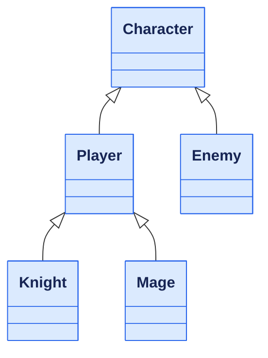
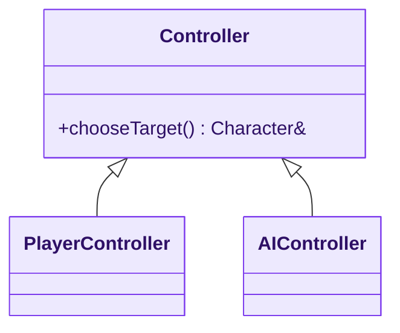
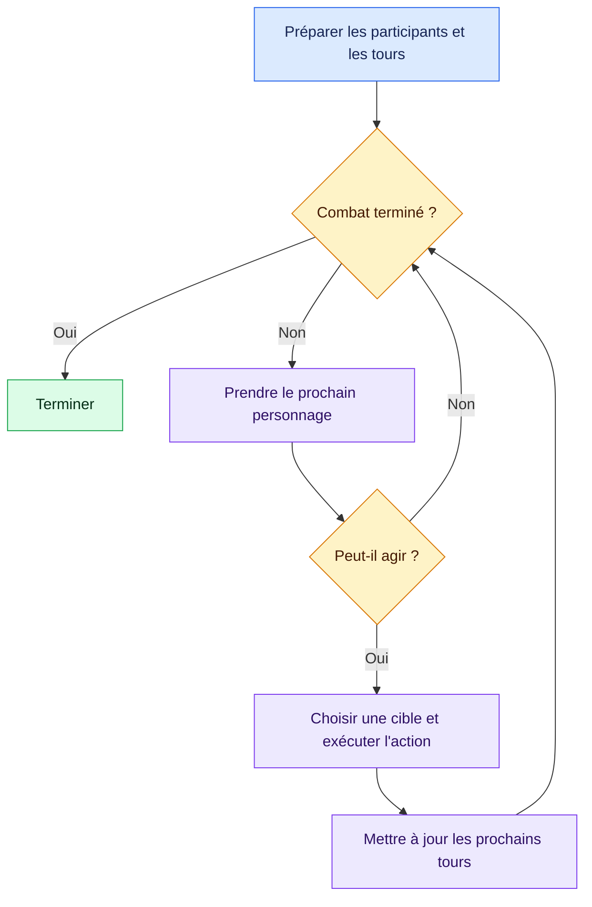
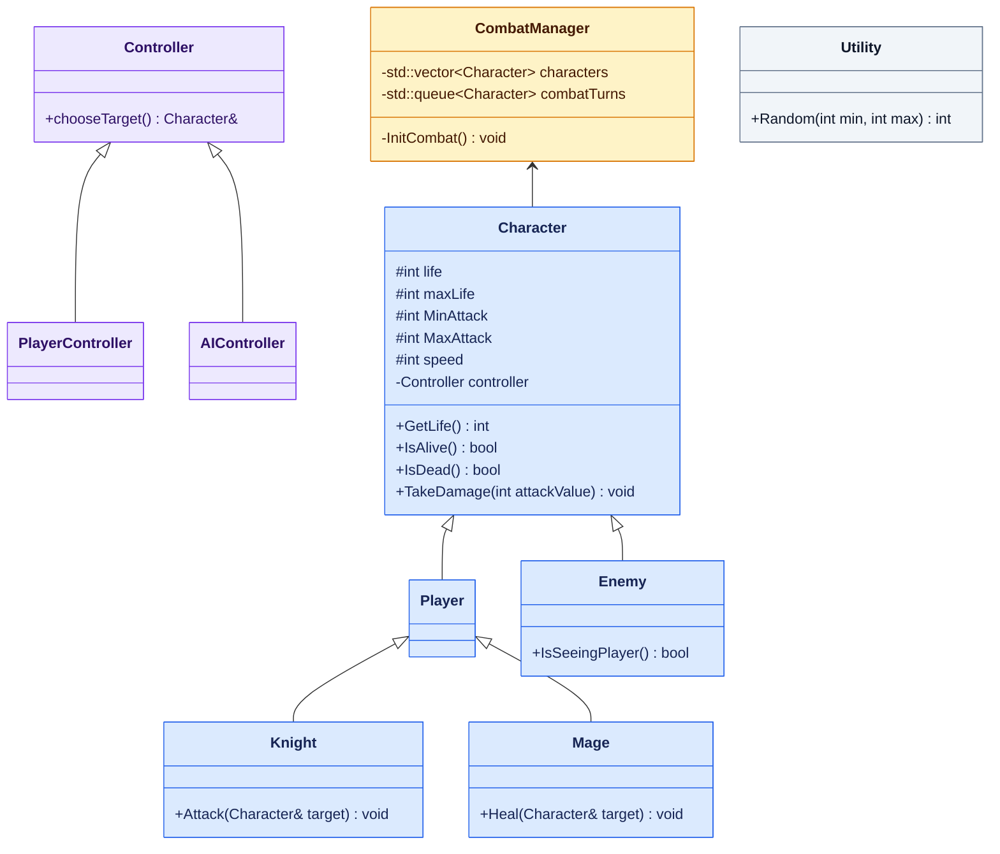

# Révision 4 : réfléchir avant de coder

[← Révision 3](./03_Const_Auto_Templates.md) · [Sommaire](./README.md)

## Objectifs

- Décrire un besoin avant d’écrire le code.
- Transformer les ambiguïtés en questions et les règles en exemples vérifiables.
- Répartir les données et les responsabilités entre les classes.
- Lire et construire un class diagram avec Mermaid.
- Distinguer le choix d’une cible, l’exécution d’une action et l’organisation du combat.
- Préparer une implémentation progressive en réutilisant les references, les types et `const`.

**Prérequis :** Avoir revu les functions dans la [révision 1](./01_Functions_Files_Compiler.md), les references et lifetimes dans la [révision 2](./02_Values_References_Pointers.md), puis `const` et les templates dans la [révision 3](./03_Const_Auto_Templates.md).

<details>
<summary>📑 Sommaire de la fiche</summary>

- [Point de départ de la séance](#point-de-départ-de-la-séance)
- [1. Commencer par décrire ce qui se passe](#1-commencer-par-décrire-ce-qui-se-passe)
- [2. Transformer les ambiguïtés en questions](#2-transformer-les-ambiguïtés-en-questions)
- [3. Écrire des exemples de résultat](#3-écrire-des-exemples-de-résultat)
- [4. Identifier ce qui est commun et ce qui varie](#4-identifier-ce-qui-est-commun-et-ce-qui-varie)
- [5. Décider qui possède l'état et qui applique les règles](#5-décider-qui-possède-létat-et-qui-applique-les-règles)
- [6. Donner une cible aux actions](#6-donner-une-cible-aux-actions)
- [7. Séparer le choix de la cible et l'exécution de l'action](#7-séparer-le-choix-de-la-cible-et-lexécution-de-laction)
- [8. Organiser le combat dans son ensemble](#8-organiser-le-combat-dans-son-ensemble)
- [9. Notre class diagram de fin de séance](#9-notre-class-diagram-de-fin-de-séance)
- [10. Vérifier la traduction en C++ avant d'écrire les bodies](#10-vérifier-la-traduction-en-c-avant-décrire-les-bodies)
- [11. Passer au code par petites étapes](#11-passer-au-code-par-petites-étapes)
- [Exercices](#exercices)
- [À retenir](#à-retenir)
- [Avant de terminer](#avant-de-terminer)
- [Références](#références)

</details>

## Point de départ de la séance

Passer d’une idée exprimée en quelques phrases à une organisation suffisamment claire pour commencer une implémentation C++.

Pendant la séance, nous avons mis les propositions en commun et construit progressivement un class diagram. Cette fiche reprend le raisonnement qui relie les besoins aux classes apparues au tableau. Le class diagram de fin de séance reste une conception en cours : certaines règles et certains choix C++ restent à préciser.

> [!IMPORTANT]
> **Définir le comportement avant le body**
> Avant d’écrire une function, il faut pouvoir expliquer ce qu’elle doit faire et donner un exemple de son résultat.

## 1. Commencer par décrire ce qui se passe

Notre point de départ est un petit combat de RPG :

- Des alliés, appelés `Player`, affrontent des ennemis, appelés `Enemy`.
- Parmi les alliés, les `Knight` attaquent et les `Mage` soignent.
- Tous les participants sont des `Character`.
- Les personnages ont de la vie et une action dont la puissance varie entre un minimum et un maximum.

Cette description n'impose pas encore de classes C++. Elle donne un vocabulaire commun et des comportements à examiner.

On peut déjà raconter deux situations :

> Un Knight choisit un Enemy comme cible, tire une puissance d'attaque entre ses bornes et lui inflige des dégâts.

> Un Mage choisit un allié comme cible, tire une puissance de soin entre ses bornes et lui rend de la vie.

Ces phrases font apparaître un acteur, une cible, une action et un changement d'état. Elles sont plus précises que « faire un système de combat ».

### À écrire avant de coder

Un paragraphe décrivant le fonctionnement attendu, puis un scénario d'attaque et un scénario de soin. Si une phrase reste ambiguë, noter une question au lieu de choisir silencieusement une règle dans le code.

## 2. Transformer les ambiguïtés en questions

« Attaquer » ou « soigner » ne suffit pas à définir un comportement complet.

| Sujet | Question à résoudre |
|---|---|
| Vie | Qu'est-ce qu'un personnage vivant ? Peut-on avoir une vie négative ? |
| Soin | Peut-on dépasser `maxLife` ? Un mort peut-il être soigné ? |
| Actions | Un personnage mort peut-il encore agir ? |
| Cible | Peut-on se cibler ? Attaquer un allié ? Soigner un Enemy ? |
| Puissance | Les bornes min/max sont-elles incluses ? Que faire si elles sont inversées ? |
| Tours | Comment `speed` détermine-t-elle l'ordre ? Que faire en cas d'égalité ? |
| Fin du combat | Quand s'arrête-t-on ? Que faire s'il n'existe plus de cible valide ? |

Le but n'est pas d'ajouter toutes les fonctionnalités imaginables. Il est de décider ce que notre première version doit prendre en charge.

Par exemple, `IsSeeingPlayer()` a été proposé comme bonus. On peut garder cette idée sur le diagramme sans implémenter la perception dans la première version.

### À écrire avant de coder

Une liste courte de règles retenues et une liste de questions encore ouvertes. Une hypothèse de travail doit être identifiable comme une hypothèse.

## 3. Écrire des exemples de résultat

Pour vérifier une règle, il faut pouvoir reconnaître un résultat correct.

> [!NOTE]
> **Un contrat à valider**
> Les résultats ci-dessous supposent que la vie reste entre `0` et `maxLife` et qu’un soin ne ressuscite pas un mort. Adapter ces exemples aux règles retenues par la classe.

| Situation | État initial | Action | État attendu avec ce contrat |
|---|---|---|---|
| Attaque ordinaire | Vie : 50 | Recevoir 12 dégâts | Vie : 38 |
| Attaque fatale | Vie : 5 | Recevoir 12 dégâts | Vie : 0, personnage mort |
| Soin ordinaire | Vie : 30, maximum : 100 | Recevoir 20 de soin | Vie : 50 |
| Soin plafonné | Vie : 90, maximum : 100 | Recevoir 20 de soin | Vie : 100 |
| Soin sur un mort | Vie : 0 | Recevoir 20 de soin | Vie : 0 |

Pour commencer, on peut choisir des montants fixes. L'aléatoire sera ajouté une fois les règles vérifiées. Une attaque entre 10 et 20 ne permet pas de prévoir une vie finale unique ; une attaque fixée à 12, oui.

### À écrire avant de coder

Pour chaque règle importante : un état initial, une action et un état attendu. Ajouter au moins un cas limite.

📖 **Pour approfondir :** [Introduction to testing your code, LearnCpp (EN)](https://www.learncpp.com/cpp-tutorial/introduction-to-testing-your-code/) explique comment vérifier de petites parties du programme, varier les entrées et comparer le résultat au comportement attendu.

## 4. Identifier ce qui est commun et ce qui varie

Tous les personnages ont une vie, peuvent être vivants ou morts et peuvent recevoir des dégâts. Ces données et comportements communs nous conduisent vers `Character`.

Les différences font ensuite apparaître des catégories :

| Classe | Rôle dans notre modèle |
|---|---|
| `Character` | État et comportements communs aux personnages. |
| `Player` | Catégorie des alliés dans le vocabulaire choisi pendant la séance. |
| `Enemy` | Catégorie des ennemis. |
| `Knight` | Allié qui attaque. |
| `Mage` | Allié qui soigne. |

L’inheritance exprime ici une relation « est un » : un Knight est un Player, qui est un Character.



`Player` n'a pas encore de member propre au tableau. Il matérialise pour le moment une catégorie. On pourra vérifier plus tard si cette classe intermédiaire apporte les distinctions nécessaires.

Attention au vocabulaire : dans notre modèle, `Player` désigne un allié. Cela ne dit pas encore comment il reçoit ses décisions.

### À écrire avant de coder

Une phrase de responsabilité par classe. Si deux classes ont exactement la même phrase, ou si une classe fait tout, revoir la répartition.

📖 **Pour approfondir :** [Inheritance, Microsoft Learn (EN)](https://learn.microsoft.com/en-us/cpp/cpp/inheritance-cpp?view=msvc-170) présente les base classes et derived classes qui correspondent aux relations « est un » de notre modèle.

## 5. Décider qui possède l'état et qui applique les règles

Le Knight connaît la puissance de son attaque. La cible connaît sa vie. Cela conduit à répartir les responsabilités :

1. Le Knight obtient une puissance d'attaque.
2. Il transmet ce montant à la cible.
3. La cible applique les dégâts à sa propre vie.

Le Knight ne devrait pas avoir à réécrire les règles de vie de chaque cible. C'est l'intérêt de `TakeDamage`.

> [!NOTE]
> **Encapsulation : préserver les règles de l’objet**
> La cible applique les changements à sa propre vie. Ses opérations peuvent ainsi préserver les invariants retenus, par exemple une vie comprise entre `0` et `maxLife`.

De la même manière, le Mage peut déterminer un montant de soin et demander à la cible de le recevoir. **L'opération qui reçoit le soin reste à ajouter ou à préciser dans le diagramme.**

| Responsabilité | Emplacement envisagé |
|---|---|
| Connaître sa vie | `Character` |
| Déterminer si l'on est vivant | `Character::IsAlive` |
| Appliquer les dégâts reçus | `Character::TakeDamage` |
| Produire une attaque | `Knight::Attack`, et une opération d'attaque à prévoir pour `Enemy` |
| Produire un soin | `Mage::Heal` |
| Recevoir un soin et en respecter les limites | Opération à prévoir sur la cible, par exemple `Character::ReceiveHeal` |

### Pourquoi `IsAlive` et `IsDead` ?

Les deux peuvent rendre les conditions plus lisibles selon le contexte. Il faut toutefois conserver une seule définition de la règle : par exemple, `IsDead()` peut renvoyer l'inverse de `IsAlive()`.

Ce sont deux points d'entrée lisibles vers une information cohérente, pas deux états indépendants à maintenir.

### Où mettre les min/max ?

Le tableau utilise `MinAttack` et `MaxAttack` dans `Character`. Il faut encore clarifier leur sens pour un Mage :

- S'ils décrivent la puissance de l'action propre à chaque personnage, des noms comme `minSkillValue` et `maxSkillValue` seraient plus généraux.
- S'ils décrivent exclusivement une attaque, il faut représenter séparément la puissance du soin.

Le choix dépend du comportement voulu. Le nom des members doit refléter cette décision.

🖼️ **Prendre du recul sur la conception :** [Design Principles, Hacking C++ (EN)](https://hackingcpp.com/cpp/design/principles.html) propose une introduction en slides aux principes de software design, en complément de la répartition des responsabilités étudiée ici.

## 6. Donner une cible aux actions

La question « qui reçoit l'action ? » fait apparaître un parameter :

```cpp
void Attack(Character& target);
void Heal(Character& target);
```

Une reference permet ici de viser un personnage existant et d'agir sur cet object. Un parameter par value créerait une copy de la partie `Character`, ce qui ne modifierait pas la cible d'origine et ferait perdre les informations de ses derived classes.

Ces signatures n'expriment pas toutes les règles du jeu : `Character&` ne précise pas à lui seul si la cible doit être un allié, un ennemi ou un personnage vivant. Cette validation reste à concevoir.

Les lectures de l'état conduiront aussi à des member functions `const`, comme `GetLife() const` et `IsAlive() const`.

### À écrire avant de coder

Pour chaque opération : qui l'appelle, quels parameters elle reçoit, quel état elle peut modifier et ce qu'elle renvoie.

## 7. Séparer le choix de la cible et l'exécution de l'action

Une autre question apparaît : **qui décide de la cible ?**

Le choix peut venir d'une personne ou d'une IA. Cette variation a fait apparaître les controllers :



La séparation envisagée est la suivante : le controller choisit, puis le personnage exécute son action sur la cible retenue.

Cela permet de réfléchir au mode de décision sans placer la saisie utilisateur ou toute l'IA directement dans `Attack` ou `Heal`.

### Ce que `chooseTarget` ne dit pas encore

Au tableau, `chooseTarget()` n'a pas de parameter. Il faudra pourtant lui donner accès aux candidats et aux informations nécessaires : personnage actif, équipes, état vivant ou mort, type d'action.

Le return type `Character&` suppose aussi qu'une cible existe. Si aucune cible n'est disponible, il faut décider du contrat : ne pas appeler l'opération dans cette situation, ou prévoir une représentation de l'absence de cible.

On peut noter ces questions sur le diagramme sans résoudre immédiatement tous les détails de l'IA.

## 8. Organiser le combat dans son ensemble

Un personnage ne devrait pas avoir à organiser tous les tours du combat. Nous avons donc fait apparaître `CombatManager` pour coordonner les participants et le déroulement.

Deux besoins distincts apparaissent :

| Besoin | Représentation envisagée au tableau |
|---|---|
| Conserver les participants | `characters`, une collection |
| Retenir l'ordre des prochains passages | `combatTurns`, une queue |

Une queue traite d'abord le premier élément ajouté : **FIFO**, first in, first out. Elle ne trie pas automatiquement les personnages par `speed`.

Il faut donc décider comment construire l'ordre des tours, comment départager les égalités et comment ignorer le tour d’un personnage mort.

Voici un **déroulement possible à valider**, pas encore une implémentation :



Ce schéma fait aussi ressortir les décisions manquantes : conditions de victoire, renouvellement des tours et comportement si aucune cible n'existe.

## 9. Notre class diagram de fin de séance

Le contenu ci-dessous reprend le tableau, avec la syntaxe des member functions adaptée à Mermaid : le return type vient après les parenthèses. Les types de stockage sont conservés pour garder la trace de la réflexion ; les précautions C++ sont expliquées juste après.



Les couleurs regroupent les **personnages en bleu**, les **controllers en violet**, la **coordination en jaune** et les **utilities en gris**. Elles servent de repères de lecture ; elles n’ajoutent aucune relation UML.

### Lire le class diagram

- `+` : public ; `-` : private ; `#` : protected.
- `Character <|-- Player` : Player est une derived class de Character.
- Une flèche simple représente une association ; elle n'exprime pas à elle seule l'ownership ou la lifetime.
- Les chevrons de templates sont représentés par des tildes dans Mermaid : `std::vector~Character~`.

La relation dessinée entre `Character` et `CombatManager` reste à préciser : les collections expriment un besoin d'accès du manager aux personnages, mais chaque personnage n'a pas nécessairement besoin de connaître le manager.

🖼️ **Lire la notation :** [Class diagrams, Mermaid (EN)](https://mermaid.js.org/syntax/classDiagram.html) fournit des exemples visuels de classes, visibilités et relations.

## 10. Vérifier la traduction en C++ avant d'écrire les bodies

Un diagramme aide à réfléchir. Il ne garantit pas qu'une traduction littérale préservera le comportement voulu.

### Conserver les vrais personnages : attention à l'object slicing

> [!WARNING]
> **Conserver le type et l’identité des personnages**
> Stocker un Knight ou un Mage dans un `std::vector<Character>` par value ne conserve que leur partie `Character` : c’est l’object slicing.

Une `std::queue<Character>` pose le même problème, et modifier une copy de la queue ne modifie pas automatiquement le participant d'origine.

Nous voulons que les tours désignent les mêmes personnages que ceux du combat. Il faudra donc choisir une représentation adaptée : les participants peuvent être possédés à un endroit, tandis que les tours conservent des identifiants ou des accès vers eux. Leur validité doit être garantie pendant le combat.

📖 **Comprendre le piège des copies :** [Object slicing, LearnCpp (EN)](https://www.learncpp.com/cpp-tutorial/object-slicing/) montre ce qui est perdu lors d’une copy de derived class vers une base class, notamment dans un vector, et compare avec des accès par reference ou pointer.

### Conserver le bon controller

Un member `Controller controller` stocké par value ne conserve pas un `PlayerController` ou un `AIController` complet. Le choix d'un accès polymorphe, de son ownership et des opérations `virtual` reste à préciser si l'on veut choisir le comportement à l'exécution.

Même question pour le personnage actif : connaître un `Character` ne donne pas automatiquement accès à `Knight::Attack` ou `Mage::Heal`. Il faudra décider comment demander l'action adaptée, par exemple avec une opération commune polymorphe. L’inheritance seule ne définit pas ce mécanisme.

📖 **Pour la traduction en C++ :** [Virtual functions, Microsoft Learn (EN)](https://learn.microsoft.com/en-us/cpp/cpp/virtual-functions?view=msvc-170) explique le choix du comportement à l’exécution à travers une reference ou un pointer vers une base class. C’est une piste à étudier pour les controllers, pas une décision déjà prise dans le diagramme.

### Autres points ouverts

- Prévoir le moyen de recevoir le soin sur la cible.
- Prévoir l'attaque de l'Enemy annoncée dans le besoin.
- Définir des constructors qui produisent un état initial valide.
- Décider comment le combat démarre : `InitCombat()` est private au tableau.
- Définir les bornes de `Random` et le cas `min == max`.
- Garder `IsSeeingPlayer()` comme bonus sans bloquer la première version.

Ces remarques prolongent la conception : elles évitent de découvrir tous les problèmes en même temps pendant l'écriture du code.

## 11. Passer au code par petites étapes

Une progression possible :

1. Construire un `Character` valide et vérifier sa vie, `IsAlive()` et `IsDead()`.
2. Vérifier `TakeDamage` avec des montants fixes et les exemples écrits.
3. Ajouter la réception du soin et vérifier ses limites.
4. Faire agir un Knight, puis un Mage, avec des cibles choisies explicitement.
5. Ajouter le choix d'une cible par un controller.
6. Coordonner plusieurs personnages et les tours dans `CombatManager`.
7. Ajouter l'aléatoire et les bonus lorsque le scénario simple fonctionne.

À chaque étape, compiler, vérifier un résultat précis et conserver une version compréhensible. On n'a pas besoin de terminer l'IA ou les tours pour tester un soin.

---

## Exercices

Pour chaque exercice : écrire les hypothèses, préciser le résultat attendu, puis vérifier la cohérence avec le diagramme.

### Exercice 1 : décrire un tour sans code • 10 min

Écrire cinq à dix lignes décrivant un tour de Knight puis un tour de Mage. Nommer à chaque étape l'object responsable. Signaler les informations manquantes plutôt que les inventer.

### Exercice 2 : compléter les cas de test • 15 min

Pour chaque situation, écrire la règle choisie et le résultat attendu : dégâts exactement égaux à la vie, personnage déjà à sa vie maximale, personnage mort au moment de son tour, deux personnages de même speed, aucune cible valide.

### Exercice 3 : vérifier la circulation de l’information • 15 min

Un Mage doit choisir un allié vivant puis le soigner. Quelles informations sont nécessaires au choix ? Qui les possède ? Quelles opérations manquent au diagramme pour réaliser le scénario ?

### Exercice 4 : préparer une évolution • 10 min

Un étudiant propose un personnage ennemi contrôlé temporairement par le joueur. Quelles parties du modèle pourraient être réutilisées ? Quelles hypothèses sur `Player`, `Enemy` et les controllers faut-il examiner ? Répondre avant d'ajouter une classe.

---

## À retenir

> [!TIP]
> **Les repères à garder**
>
> - Un scénario décrit un acteur, une action, une cible et un résultat.
> - Un exemple précis permet de vérifier une règle avant son implémentation.
> - Chaque classe doit avoir une responsabilité que l’on peut expliquer.
> - Le controller choisit ; le personnage exécute ; le CombatManager coordonne.
> - Un class diagram rend visibles les décisions et les questions encore ouvertes.
> - Une copy, une reference et un pointer n’ont pas les mêmes conséquences sur l’identité et la lifetime des participants.

### Méthode à réutiliser dans vos projets

1. **Décrire** le résultat attendu avec des phrases et un vocabulaire précis.
2. **Questionner** les ambiguïtés et délimiter la première version.
3. **Illustrer** les règles par des exemples vérifiables.
4. **Répartir** les données et responsabilités.
5. **Dessiner** les relations et le déroulement.
6. **Préciser** les signatures, les accès et les lifetimes.
7. **Implémenter** une étape à la fois et vérifier les exemples.

Le diagramme peut évoluer pendant le travail. Son utilité est de rendre les décisions visibles et discutables avant qu'elles soient dispersées dans le code.

## Avant de terminer

- [ ] Je sais décrire un scénario de combat sans écrire de code.
- [ ] Je distingue une règle retenue, une hypothèse et une question ouverte.
- [ ] Je sais écrire un état initial, une action et un état attendu.
- [ ] Je peux expliquer la responsabilité de chaque classe du diagramme.
- [ ] Je sais lire les visibilités et une relation d’inheritance dans Mermaid.
- [ ] Je distingue choisir une cible, agir sur elle et organiser les tours.
- [ ] Je peux expliquer pourquoi les tours doivent désigner les personnages d’origine.
- [ ] Je sais proposer une première étape d’implémentation vérifiable.

---

## Références

- [Design Principles, Hacking C++ (EN)](https://hackingcpp.com/cpp/design/principles.html) : Introduction en slides aux principes de software design pour prolonger la réflexion sur les classes et leurs responsabilités.
- [Introduction to testing your code, LearnCpp (EN)](https://www.learncpp.com/cpp-tutorial/introduction-to-testing-your-code/) : Vérification progressive, choix des entrées et comparaison avec les résultats attendus.
- [Object slicing, LearnCpp (EN)](https://www.learncpp.com/cpp-tutorial/object-slicing/) : Exemples de copies vers une base class, de stockage dans un vector et d’accès par reference ou pointer.
- [Class diagrams, Mermaid (EN)](https://mermaid.js.org/syntax/classDiagram.html) : Syntaxe des attributes, methods, visibilités, relations et types génériques pour refaire les schémas de la fiche.
- [Inheritance, Microsoft Learn (EN)](https://learn.microsoft.com/en-us/cpp/cpp/inheritance-cpp?view=msvc-170) : Le lien entre base classes et derived classes pour préparer la traduction de Character, Player, Knight et Mage en C++.
- [Virtual functions, Microsoft Learn (EN)](https://learn.microsoft.com/en-us/cpp/cpp/virtual-functions?view=msvc-170) : Lecture complémentaire pour comprendre comment appeler un comportement adapté à travers une reference ou un pointer vers une base class. Ce mécanisme reste à préciser dans notre conception.

---

[← Révision 3](./03_Const_Auto_Templates.md) · [Sommaire](./README.md)
